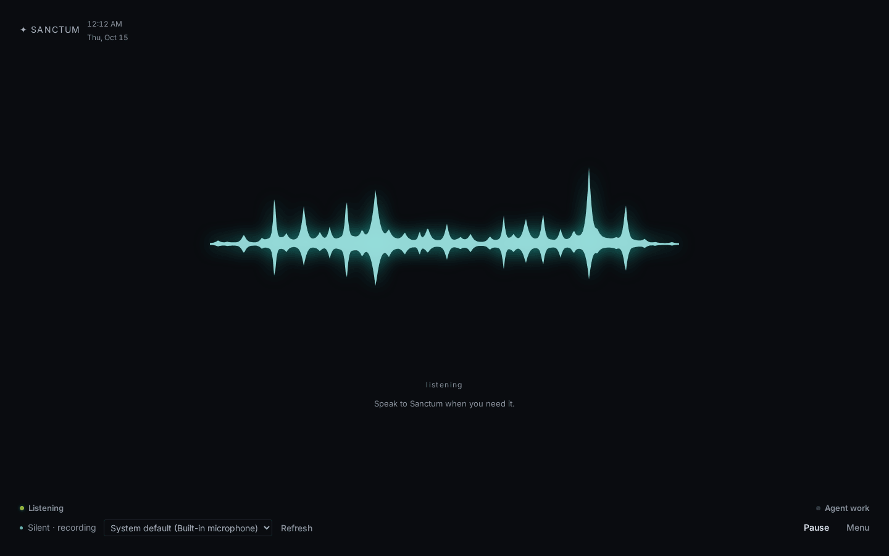
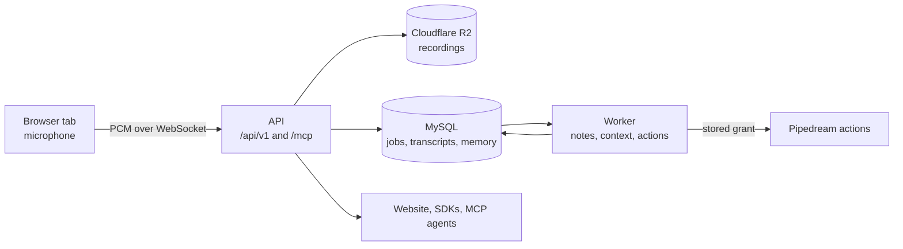

<h1 align="center">🎙️ Sanctum</h1>

<div align="center">

**Quiet AI meeting notes and shared agent memory, from one browser tab.**

[](https://github.com/i098/sanctum/actions/workflows/ci.yml)
[](https://github.com/i098/sanctum/releases/latest)
[](LICENSE)
[](https://github.com/i098/sanctum/stargazers)
[](https://github.com/i098/sanctum/commits/main)
[](https://github.com/sponsors/i098)

[Try it](https://sanctum.42nights.dev) · [Self-host](#self-host) · [Docs](https://i098.github.io/sanctum/) · [Changelog](CHANGELOG.md) · [Contribute](CONTRIBUTING.md)



*The Listen screen while recording: fullscreen and silent, with the waveform following the live microphone.*

</div>

Sanctum is fair-source AI meeting notes and meeting transcription for teams and their agents.
It listens through your browser microphone, keeps the full transcript and private recording, and works as a voice assistant only when someone asks.
It turns the meeting into time-aware agent memory that people and agents share through an API, TypeScript and Python SDKs, and a remote Model Context Protocol (MCP) server.

## Features

- **[Silent capture](docs/DESIGN.md):** browser microphone capture with a fullscreen waveform. Sanctum never speaks unless you address it directly.
- **[Spoken requests](docs/DECISIONS.md#spoken-work-decision---2026-10-10):** say "Sanctum, look up the train times". Sanctum answers "Looking that up." and files a cited answer in Review.
- **[Full transcripts and recordings](docs/operations.md#configuration):** the complete transcript and the private audio stay in Cloudflare R2, separate from selective memory.
- **[Shared agent memory](docs/ARCHITECTURE.md#interfaces-t22-t23):** decisions, commitments and facts linked to speakers, timestamps and source passages. One versioned API serves the website, the [SDKs](sdk/README.md) and remote MCP.
- **[Integrations with per-action grants](docs/ARCHITECTURE.md#pipedream-t17):** Pipedream actions are found on demand. An action runs only with a stored grant, and each run leaves a truthful receipt.
- **[Teams and workspaces](docs/operations.md#sign-in):** sign in with WorkOS, or self-host the embedded issuer. Access follows workspace membership everywhere.

The capture tab must stay open and the device must stay awake.
Sanctum does not record after the browser closes or the device sleeps.
Server-side work continues after the tab closes.

## Quick start

**Try it:** open [sanctum.42nights.dev](https://sanctum.42nights.dev), sign in, allow the microphone, and choose Listen.

<a id="self-host"></a>

**Self-host:** you need Docker, a MySQL password, and Node.js 24.12 or later. The stack runs MySQL, the API, the worker, and Caddy from one image.

```bash
git clone https://github.com/i098/sanctum.git
cd sanctum
export MYSQL_PASSWORD=...        # choose a strong password
export SANCTUM_ENV=development   # production needs every decision selected
docker compose up -d mysql
docker compose run --rm api node server/dist/migrate.js
docker compose up -d api worker caddy
```

[Operations](docs/operations.md) lists every setting, sign-in option, migration step, and recovery step.

## How it works



One Node.js image runs the API and the worker.
MySQL holds the durable job ledger, so a restart loses no work.
[Architecture](docs/ARCHITECTURE.md) describes each slice and its contracts.

## Repository layout

- [`web-app/`](web-app/): the React website and the Listen screen.
- [`server/`](server/): the API, the MCP server, the workers, and the MySQL migrations.
- [`packages/contracts/`](packages/contracts/): the shared Effect Schema contracts.
- [`sdk/`](sdk/): the generated TypeScript and Python clients, with examples.
- [`deploy/cloudflare/`](deploy/cloudflare/): the Cloudflare Worker and container deployment.
- [`design/`](design/): the visual references for the Listen screen.
- [`docs/`](docs/): the design, decisions, operations, CI, and release evidence.
- [`docs/build/`](docs/build/): the build handoff, plan, and task checklist.
- [`benchmarks/`](benchmarks/), [`scripts/`](scripts/), and [`tests/`](tests/): measurement, tooling, and checks.

## More docs

- [Design contract](docs/DESIGN.md)
- [Decisions](docs/DECISIONS.md)
- [Implementation plan](docs/build/tasks/plan.md)
- [CI/CD](docs/CI.md)
- [Release evidence](docs/release-evidence.md)
- [Security](SECURITY.md)

## Contributing

Contributions to requirements, API design, accessibility, evaluation fixtures and code are welcome.
Read [CONTRIBUTING.md](CONTRIBUTING.md) before you start.
Use synthetic meeting content in public issues and tests.
Never upload private recordings or credentials.
Report security issues through [SECURITY.md](SECURITY.md).

## License

Sanctum is fair source under the [Functional Source License, Version 1.1, ALv2 Future License](LICENSE) (FSL-1.1-ALv2).
You can use, copy, modify, and redistribute it for any purpose except a competing commercial product or service.
Each version becomes available under Apache 2.0 two years after its release.
Third-party services and referenced projects keep their own terms and licenses.
